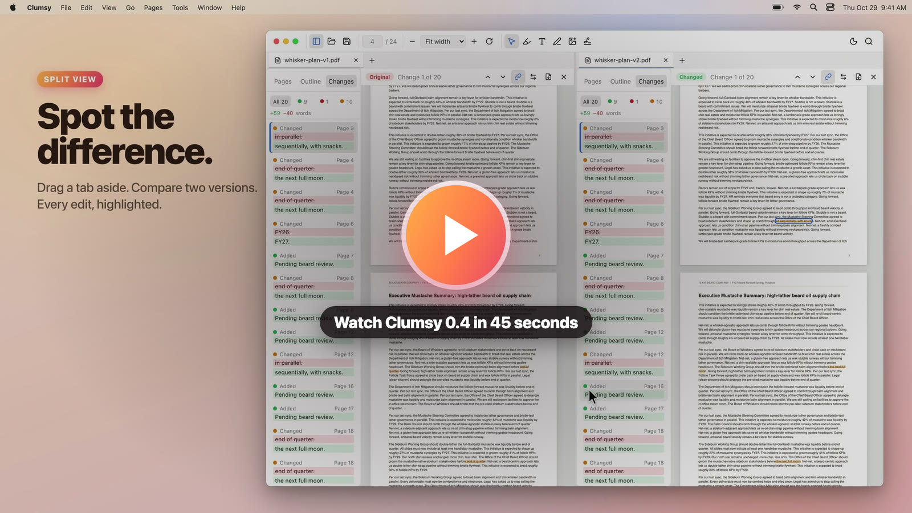

# Clumsy

No tricks, no acrobatics.

Clumsy is a small, fast PDF viewer, built because opening a PDF shouldn’t require an update first. It opens PDFs in tabs and lets you search, highlight, annotate, fill forms, and sign, saving everything straight back into the file. Dark mode inverts the text while leaving images alone. Markdown files open formatted too, with their source one shortcut away.

[](docs/media/clumsy-0.4-tour.mp4)

## Features

**Reading PDFs**
- Tabs, split panes (⌘\), and multiple windows. Drag a tab between panes or windows, or out of the window to give it its own.
- Thumbnails, the document's outline, and a Document Map beside each page showing where you are (⌥⌘B).
- Find with match case, whole words, regular expressions, and accent-insensitive matching.
- Vertical, horizontal, wrapped, or page scrolling, with odd or even spreads.
- Go Back and Go Forward (⌃- / ⌃⇧-) through link, outline, and search jumps.
- Page labels like "iv" or "A-3" in the page box and Go to Page.
- Dark pages that invert the text and leave photos alone, the Hand tool (hold Space), and Caret Browsing (F7).

**Marking up**
- Highlight, text notes, freehand drawing, images, and signatures, with colors, thickness, opacity, and font size.
- Fill in forms.
- Everything saves straight back into the PDF, and Clumsy asks first if another app changed the file since you opened it.

**Changing pages**
- Reorder pages by dragging thumbnails, and rotate, delete, or extract them.
- Insert pages from other PDFs or images, and combine several PDFs into one.
- Make a new PDF from images, with phone photos right side up and JPEGs at their original quality.
- Set page labels (Pages > Page Labels…).
- Every page change can be undone.

**Comparing and exporting**
- Compare two PDFs side by side. Changed, added, and removed text is highlighted on both, with a list of every change, linked scrolling, and an exportable report.
- Export pages as PNG or JPEG at 72, 150, or 300 dpi.

**Markdown**
- `.md` files open formatted: tables, task lists, footnotes, code highlighting, images next to the file, and links to other Markdown files and PDFs.
- ⇧⌘V switches to the source to edit it and back, keeping your place.
- An outline of the headings, a minimap (⌥⌘B), find in both views, and zoom.
- Files reload on their own when another app changes them, as long as you haven't edited them.

**Getting around**
- Command Palette (⇧⌘P) and Go to File (⌘P), with shortcuts that follow VS Code's where they can. ⌘K lists them all.
- Recent files, Reopen Closed Tab (⇧⌘T), and Save All (⌥⌘S).
- Can be your default app for PDFs and Markdown files (Clumsy menu).
- Updates install from inside the app, and restarting brings every window and tab back where it was.

## Download

Grab `Clumsy.dmg` from the [latest release](https://github.com/ry4nolson/clumsy/releases/latest). Builds are currently for macOS: universal (Apple Silicon and Intel), signed, and notarized. Windows and Linux builds are planned. After that, Clumsy updates itself: it offers each new version and installs it in place.

## Development

```bash
pnpm install
pnpm tauri dev
```

Architecture, release process, and conventions are documented in [AGENTS.md](AGENTS.md).

## License

Clumsy's source code is released under the [MIT License](LICENSE).

The Clumsy name and app icon, and the Texas Beard Company name and logos, are not covered by the license. Forks are welcome; please ship them under a different name and icon.

Sponsored by [Texas Beard Company](https://www.texasbeardcompany.com).
